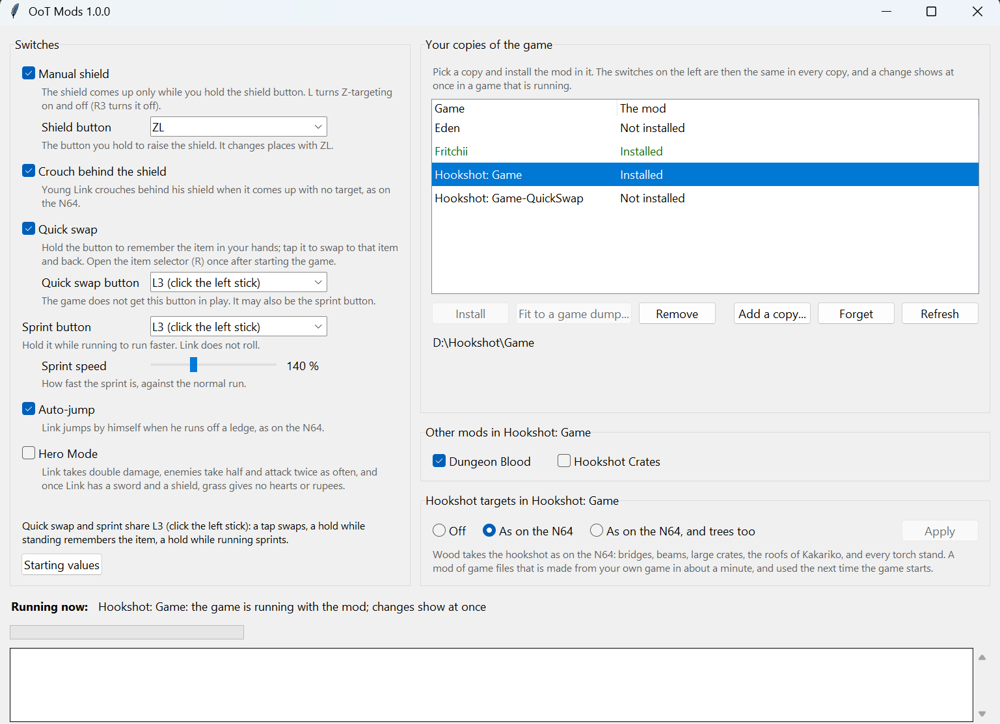

# OoT Remake Mods

One mod with a settings window for the Switch 2 remake of *The Legend of Zelda: Ocarina of Time*
(title `0400486024DEC000`). It works in Switch emulators (Fritchii / Lichii, Eden and others that load mods
the same way) and in **Hookshot** game folders (the PC recompile).

> **No game files are included.** The installer changes your own copy of the game on your PC, and builds the
> hookshot targets from your own game files.



## What it adds

| Switch | Starts as | What it does |
|---|---|---|
| **Manual shield** | on, **ZL** | The shield comes up only while you hold the shield button. **L** turns Z-targeting on and off, **R3** turns it off. |
| **Crouch behind the shield** | on | Young Link crouches behind his shield when it comes up with no target, as on the N64. |
| **Quick swap** | on, **L3** | Hold the button for a moment to remember the item in your hands. Tap it to swap to that item, tap again to swap back. |
| **Sprint** | on, **L3**, 140 % | Hold the button while running to run faster. Link does not roll. |
| **Auto-jump** | on | Link jumps by himself when he runs off a ledge, as on the N64. |
| **Hero Mode** | off | Link takes double damage, enemies take half and attack twice as often, and once Link has a sword and a shield, grass gives no hearts or rupees. |
| **N64 hookshot targets** | off | The hookshot latches on to what it did on the N64: the wood of bridges, beams, scaffolds, awnings, large crates and Kakariko's roofs, and every torch stand. Trees are an optional extra. |

Every switch can be changed in the window while the game runs, and the change shows at once. You can choose the
button for the shield (ZL, ZR, L, R, R3, L3), for quick swap (L3, R3, D-pad up, D-pad right, Minus) and for the
sprint (L3, R3, B, ZR), and the sprint's speed (110 to 200 %).

Good to know:

- Quick swap and the sprint may share a button (they do at the start, on L3): a tap swaps, a hold while standing
  still remembers the item, a hold while running sprints.
- After starting the game, open the item selector (R) once. Quick swap learns your items from it.
- The item you remembered is forgotten when the game closes.
- The shield's button changes places with ZL. With the shield on ZR, for example, ZL does what ZR did.
- While you play the ocarina, and in menus and scenes, every button is the game's own.
- The hookshot targets are a mod of game files, made from your own game. They are separate from the switches:
  taking the mod out leaves them, and they have their own Off choice.

## What you need

- Windows 10 or 11.
- **Python 3.8 or newer** from [python.org](https://www.python.org/downloads/). The standard installer brings
  everything the window uses.
- The game, in an emulator or as a Hookshot game folder.
- For a Hookshot game folder: **Hookshot Builder**. The mod is compiled into the game, so the game is built
  again (about a quarter of an hour).
- Only in some cases, your dump of the game (a `.nup` file, or a folder with its `exefs` and `romfs`):
  - in an emulator, when your game is a version other than 1.1.1, so that the mod can be fitted to it;
  - for the hookshot targets, when no Hookshot game folder is on the PC to take the game's files from.

  Reading a dump needs two Python packages. If Hookshot Builder is on the PC, its own copies are used and
  there is nothing to install. Otherwise, with Python 3.9 or newer: `python -m pip install -r requirements.txt`.

## Install

1. [Download the latest release](../../releases/latest) and unzip it anywhere. Keep the folder: the window
   lives in it.
2. Close the game.
3. Open **`OoT Mods.cmd`** (or `OoT Mods.pyw`).
4. The window lists every copy of the game it finds. Pick one and press **Install**.
5. Set the switches as you like. They are saved in every copy that has the mod.

If a copy is missing from the list, press **Add a copy...** and choose the Hookshot game folder, or the
emulator's data folder (the one that holds `load`).

If another mod in a copy replaces the game's code file `main` (for example *Manual Shield + Favorite*), it
cannot work beside this one. The window says so and offers to turn it off; nothing is deleted.

## Updates: what stays and what needs a click

| What changed | What happens |
|---|---|
| A new version of the **emulator** | Nothing to do. The mod sits in the emulator's mod folder, which an update leaves alone. |
| A new version of **Hookshot Builder** builds the game again | Nothing to do. The mod is in the code the game folder keeps, so every build has it. |
| A new version of **this mod** | Open the new window. Copies with an older version say **Update**. Your switches carry over. |
| A new version of **the game**, or a Hookshot game folder made again from the dump | Open the window. The copy says **Repair** or **Install**: one click fits the mod to the game again. An emulator asks for your dump of the new version. |

The mod is not tied to one version of the game. It finds each place it needs by the shape of the code around
it. If a part cannot be found in a new version, that part is left out and named, and the others still work.

## The window

- **Switches**: change them at any time. A running game gets them at once, and every copy with the mod saves
  them.
- **Copies of the game**: how the mod stands in each (Installed, Not installed, Update, Repair) with one button
  that does what is needed, plus **Remove**.
- **Other mods in this copy**: turn a copy's other mods on and off. This is how *Dungeon Blood*
  (by REXCRAFT88) is switched if you have it. It is not part of this project.
- **Hookshot targets**: Off, as on the N64, or as on the N64 with trees too. **Apply** builds the files (some
  seconds; about 180 MB).
- **Running now**: says which running games have the mod. For an emulator it does not recognize, press
  **Search the running emulator**.

## Command line

Everything the window does, without the window:

```
python install.py                 the copies of the game, and how the mod stands in each
python install.py install 2       put the mod into copy 2, or update or repair it there
python install.py install 2 --game "D:\dumps\OoT.nup"      ...fitting it to that dump
python install.py remove 2        take it out again
python install.py set sprint=R3 sprint_speed=150 hero=on   set switches, also in the running game
python install.py get             show the switches and what each can be
python install.py files 2         make the N64 hookshot targets (--trees: trees too; --off: turn them off)
python install.py mods 2 "Dungeon Blood" off               turn another mod of a copy off
python install.py live            say which running games have the mod
python install.py -h              every command
```

## Limits

- **Hookshot has no tab for this in its Insert menu.** That menu is part of the Hookshot program, which every
  builder update replaces, so a tab there would not last. The window does the same job for emulators and
  Hookshot alike, also while the game runs.
- Tested with game version 1.1.1 on Windows 11. In a Hookshot game (Hookshot Builder 2.1.0) every switch was
  played. In Fritchii 5.8.4 the mod loads with all of its branches in place and takes changes while the game
  runs; there it was not played through. Other versions of the game are fitted by pattern, and that has not
  been tried on a truly different version yet.
- Other mods that patch the game's code (`.ips`, `.pchtxt`) are checked only roughly. If one changes the same
  instruction as this mod, one of the two wins.
- A Hookshot game built with DLSS may need its next build done in Hookshot Builder itself.
- The hookshot targets change the baked collision of about 60 map squares. Another file mod that ships the same
  squares cannot be combined with them. *Hookshot Crates* is turned off when they are built, because they
  include it.
- Hero Mode's faster enemy attacks were built as described, but the timing was not measured in play.
- Game dumps were read with the readers Hookshot Builder brings. Reading one with the `zbic` package from
  `requirements.txt` instead follows that package's documented use, but was not run.

## How it works

The game's own code stays as it is except for about twenty single instructions, each replaced by a branch.
The mod's code is a module of its own (`subsdk9`) that the game loads beside its own. In an emulator both are
an ordinary mod folder (`load/0400486024DEC000/OoT Mods/exefs`: the module and one `.ips` patch). In a Hookshot
game folder they go into the code the folder keeps (`.hookshot_exefs`), and the recompiler turns the module
into PC code together with the game.

The switches live in a small block of the module's data. The window writes that block in the installed file,
and in the memory of a running game.

### Building the module yourself

Players do not need this: the built module is in `module/`. The sources are in `src/`.

```
python tools/build_module.py
```

It needs `clang` and `ld.lld` (LLVM 17 or newer): from the folder named in `OOTMODS_LLVM`, from a Hookshot
Builder on the PC, or from `PATH`. `tools/lift_check.py` asks the Hookshot recompiler whether it can translate
every instruction of the module, which saves a failed build.

## Credits and license

- **Manual Shield** (and its crouch) is the work of **REXCRAFT88**:
  https://github.com/REXCRAFT88/OOT-Mods-by-rexcraft88. This project ports it into the module.
- **Dungeon Blood** is REXCRAFT88's too. It is not included here.
- Everything else: RickyZPR, developed with Claude Code (Anthropic).

See [CREDITS.md](CREDITS.md). Licensed under the [GNU General Public License v3.0](LICENSE).

*The Legend of Zelda: Ocarina of Time* is © Nintendo. This project is not affiliated with Nintendo, with any
emulator, or with Hookshot.
